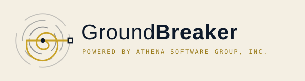
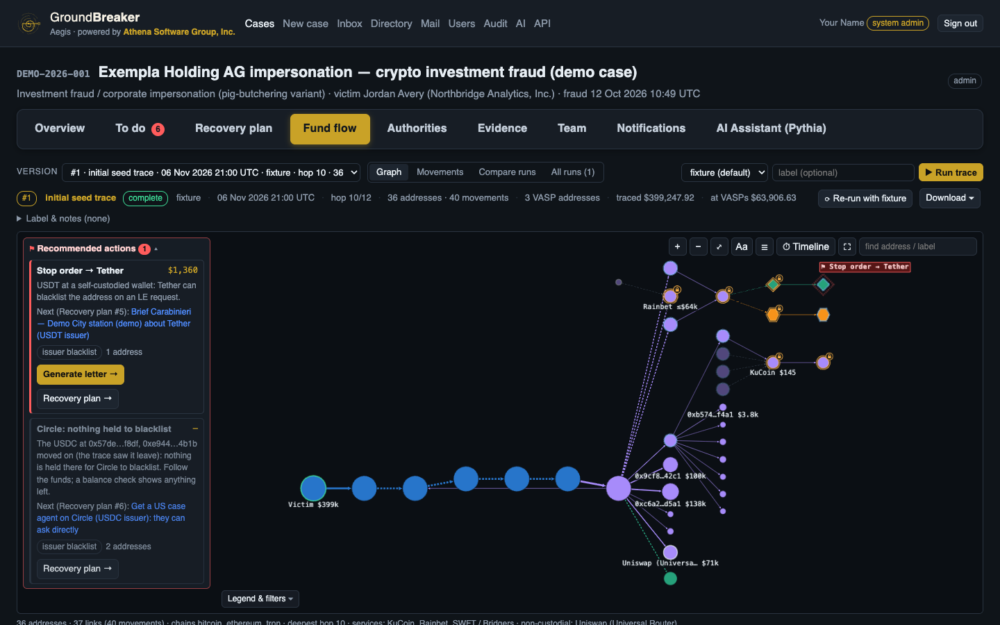
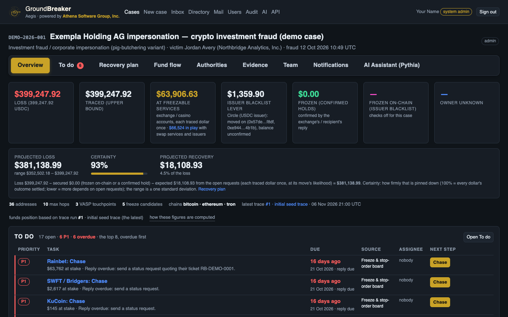
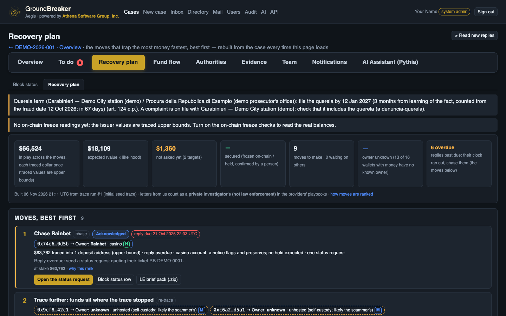

<p align="center">
  <picture>
    <source media="(prefers-color-scheme: dark)" srcset="brand/groundbreaker-lockup-dark.svg">
    
  </picture>
</p>

<p align="center">
  <strong>Trace stolen crypto, find who can freeze it, and run the requests that get it frozen.</strong>
</p>

<p align="center">
  <a href="https://github.com/Athena-Software-Group/groundbreaker/actions/workflows/ci.yml"></a>
  <a href="https://github.com/Athena-Software-Group/groundbreaker/releases"></a>
  <a href="LICENSE"></a>
  
</p>

GroundBreaker is an open-source case workspace for crypto-fraud response. You give it the fraudulent
transaction. It follows the money forward across chains, shows which exchanges, stablecoin issuers and
other services can freeze or preserve it, drafts the letters they need, and tracks every reply until
the funds are held or the trail ends.

It is for fraud investigators, incident-response teams, compliance teams and the lawyers who work with
them. Most tracing tools stop at the graph. In a real case the graph is the first hour, and the rest
is correspondence against the clock: who to ask, what they need, who has gone quiet and what to do
next. GroundBreaker keeps both in one place.



> **Status: public beta (0.9).** Use it with care on live cases and read [Known limitations](#known-limitations)
> first. GroundBreaker never holds keys and never moves funds: all chain access is read-only.

## What it does

| | |
|---|---|
| **Trace** | Forward tracing from the origin transaction across EVM chains, TRON and Bitcoin, through swaps and bridges. Every run is kept as a version you can compare. Graph, timeline and movement exports. |
| **Find the freeze points** | Marks exchanges, casinos, swap services and issuers the funds reached. Reads Tether and Circle blacklist status and frozen balances on-chain. Identifies wallet owners with a confidence level. |
| **Act** | A board of who to ask and what is overdue, with one open request per provider. Provider playbooks give the right channel and what each one requires. Letters are generated from the trace, then sent by hand or through Microsoft 365. |
| **Track** | Replies are matched to requests and classified, and a person confirms every freeze or hold. Block status shows what each authority has answered. |
| **Plan** | A Recovery plan ranks the moves that trap the most money fastest, with projected loss and how certain it is. A To do list collects the work across the case and closes items itself as the work gets done. |
| **Keep it defensible** | Evidence vault with SHA-256 chain of custody, per-case roles with time-limited external access, and a hash-chained audit log. |
| **Pythia, the AI assistant** | Fund-flow analysis, stop-order drafting, follow-ups, wallet briefings, law-enforcement updates and client status summaries. Per case it runs redacted, full or off. It only prepares drafts: sending is always a person's step. |

## Quick start

This runs the fictional demo case on SQLite, with no Docker, no database server and no API keys. It
needs Python 3.12 or newer and takes about two minutes.

```bash
git clone https://github.com/Athena-Software-Group/groundbreaker.git
cd groundbreaker
python3 -m venv .venv && source .venv/bin/activate
pip install -r requirements.txt

export DATABASE_URL=sqlite:///./aegis.db
export APP_SECRET_KEY=$(openssl rand -hex 32)
export AEGIS_OWNER_LOOKUPS_DISABLED=1   # keeps the demo fully offline; see "Data and privacy" below

alembic upgrade head
python -m scripts.seed_case             # loads the demo case DEMO-2026-001 and runs its first trace
python -m scripts.create_user you@example.com "Your Name" --system-admin
uvicorn app.main:app --port 8000
```

Open <http://127.0.0.1:8000> and sign in with the account you just created. For Docker and Postgres, see
the [guide](docs/guide.md#1-quick-start-local).

### A five-minute tour

Open **DEMO-2026-001**. Its people, companies and references are invented, and it cannot e-mail real
domains, so you can click anything.

1. **Overview:** the loss, what was traced, what can be frozen, and the projected loss.
2. **Fund flow:** hover over a wallet to see what went through it and who owns it. Switch to **Timeline** to see the same flow over time.
3. **Recovery plan:** the ranked moves, each with its reasoning and next step.
4. **Authorities:** every exchange, issuer and police contact on the case. Open a provider's playbook, then generate a letter from the trace.
5. **AI Assistant (Pythia):** try `/summary` or `/stop-orders`. With no model configured it answers from rules alone.





## How it works

```
origin tx ─▶ perpetrator wallet ─▶ laundering hops ─▶ exchange deposit ─▶ hot wallet (stop)
                                   └─▶ swap contract ─▶ other chain ─▶ USDT-TRON / BTC
                                                                        ▲ issuer blacklist lever
```

The tracer walks forward in time from the origin transaction and allocates the stolen value across each
wallet's outflows, earliest first. It stops where a service could act: a deposit address, a hot wallet
or a swap contract. Each of those becomes a target with a playbook, a letter and a clock.

Built with Python, FastAPI, SQLAlchemy and Alembic, on Postgres or SQLite. The interface is server-rendered
and has no CDN dependencies. Chain data comes from Etherscan or Blockscout, TronGrid and mempool.space.

## Using it on a real case

Read [docs/data-handling.md](docs/data-handling.md) first. It sets out what may enter the repository and
what leaves your machine. In short:

1. **Keep real case data out of this repository.** Keep the case file in a private folder outside the
   repository and point `AEGIS_FIXTURE_PATH` at it. The rules, `.gitignore` and `scripts/pii_scan.py` exist
   to stop victim data reaching git.
2. **Set your sender of record** with `AEGIS_ORG_NAME` and `AEGIS_SIGNATORY_NAME`. Letters go out in your
   organisation's name, on behalf of the client.
3. **Decide what may go live, case by case.** See below.
4. **Run the scheduler** with `python -m scripts.run_scheduler`. It handles overdue checks, on-chain freeze
   checks and mailbox sync. Nothing updates in the background without it.

### Data and privacy

Querying a wallet on a public explorer discloses that someone is interested in it, and that can tip off
the people you are chasing. These are the features that send data out:

| Feature | What is sent | Where | Default |
|---|---|---|---|
| **Owner lookups** | Case wallet addresses | Blockscout (Tronscan with a key) | **On** for every case. Turn it off per case, or everywhere with `AEGIS_OWNER_LOOKUPS_DISABLED=1` |
| **Live trace** | Wallet addresses and transaction hashes | Etherscan or Blockscout, TronGrid, mempool.space | Off: `PROVIDER_MODE=fixture` |
| **On-chain freeze checks** | Case wallet addresses | A JSON-RPC node, TronGrid, an explorer | Off until a case admin consents |
| **Pythia** | Case context, redacted by default | The configured model host | Off without a model; the mode is set per case |
| **Microsoft 365 mail** | Letters and replies | Microsoft Graph | Off: manual "draft, you send" mode |

## Documentation

| | |
|---|---|
| [Guide](docs/guide.md) | The full reference: setup, configuration, roles, e-mail, the assistant and the scheduler |
| [Data handling](docs/data-handling.md) | What may enter the repository, egress rules and redaction |
| [Fixture schema](docs/fixture-schema.md) | The case file format |
| [Freeze detection](docs/freeze-detection.md) · [Wallet owners](docs/wallet-owners.md) | How freeze status and ownership are worked out |
| [Recovery plan](docs/recovery-plan.md) · [Block status](docs/block-status.md) · [Playbooks](docs/playbook.md) | How moves are ranked, replies tracked and providers modelled |
| [Evidence intelligence](docs/evidence-intel.md) · [To do](docs/todo.md) | Reading evidence and the case task list |
| [Microsoft 365 setup](docs/m365-setup.md) · [AWS deployment](docs/aws-deployment.md) | Mail and hosting |

## Known limitations

- **Values are estimates.** Traced figures are upper bounds from a chronological allocation model. They show where money could have gone, not who owns it. USD values come from a static price table, not historical prices.
- **Live tracing is the least-tested path.** The offline provider is exercised by the test suite. Wallet history reads return at most the first 1,000 rows, so busy wallets are cut short.
- **A live trace needs an API key in practice.** Keyless Blockscout allowed about 10 requests an hour in our last test, which is too few to trace a case. Set `ETHERSCAN_API_KEY`.
- **Loops double-count.** When funds return to a wallet already in the trace (A → B → A), the second arrival adds to its traced value. Record a swap with a counterparty as a single leg until this is fixed.
- **Provider details go stale.** Playbooks record each claim's source, but channels and requirements change. Check them before you rely on them.
- **Not legal advice.** Deadlines and legal routes are prompts for you and your counsel. Recovery is never guaranteed.

The roadmap is in the [guide](docs/guide.md#7-roadmap).

## Contributing

Issues and pull requests are welcome. Before your first commit, read
[docs/data-handling.md](docs/data-handling.md): real case data must never enter this repository, including
in tests, fixtures, logs and screenshots.

```bash
pip install -r requirements-dev.txt
pytest                         # offline, on the demo case; the full suite takes 15 to 20 minutes
ruff check app tests scripts
python scripts/pii_scan.py     # the same scan CI runs
```

## Security

Please report vulnerabilities through GitHub's private vulnerability reporting, not in a public issue. See
[SECURITY.md](SECURITY.md).

## Licence

GroundBreaker is licensed under the [GNU Affero General Public License v3.0](LICENSE). If you run a modified
version as a network service, you must offer its users the corresponding source. The licence covers the code
only: it grants no right to use the GroundBreaker or Athena names, logos or other marks. Third-party notices
are in [NOTICE](NOTICE).

"Aegis" is the project's codename, so you will see it in the code and in `AEGIS_*` settings.

© 2026 Athena Software Group, Inc.
